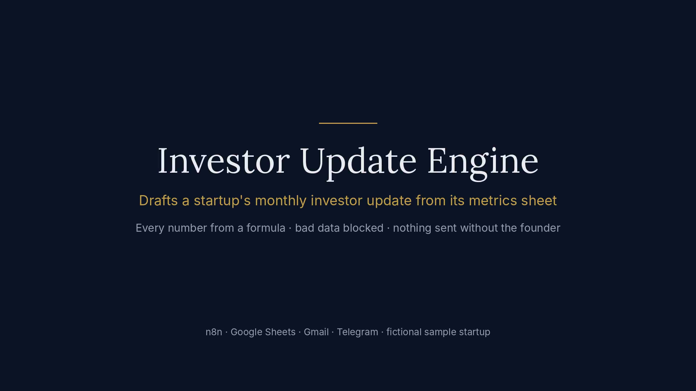
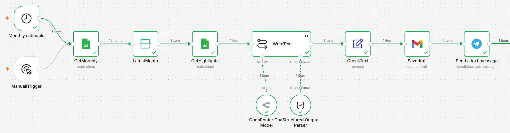

# Investor Update Engine

**Drafts a startup's monthly investor update from its metrics sheet.**
Every number comes from a formula, bad data is blocked before it reaches investors, and nothing is sent without the founder.

Built in n8n with Google Sheets, Gmail, Telegram and a free AI model. Zero code nodes.

> All data in this repo belongs to a **fictional sample startup**. No real company data is used.

📄 **[Read the full report](https://claude.ai/artifact/AuKC18Zjp8reG2tZ5R3RAK)** — method, tests, benefits and time saved.

---

## Demo (47 sec)

---

## Results

| | |
|---|---|
| **Tests passed** | 11 of 11 |
| **Bad data caught** | 5 of 5 (cash, customers or MRR don't add up, empty cell, missing month) |
| **Warning rules** | 3 of 3 triggered correctly, 0 false alarms in a healthy month |
| **AI safety** | invents nothing when notes are empty; any number in AI text holds the draft back |
| **Time per update** | 20 min 43 s by hand → about 3.5 min (27.6 s run + 3 min founder review) |
| **Cost** | €0 (free OpenRouter model, Google Sheets, Gmail) |

Full results: [`tests/test_results.csv`](tests/test_results.csv)

---

## What a founder gets

| Benefit | How |
|---|---|
| **No wrong numbers to investors** | Every figure comes from a formula in the founder's own sheet, never from AI |
| **Bad data stopped before it goes out** | 5 data checks; any failure marks the draft `DATA ERROR` in the subject line |
| **Early warning on risk** | Burn spike, short runway, falling MRR, high churn and shrinking pipeline flagged automatically |
| **AI can't make things up** | AI writes text only, from the founder's notes, with no digits allowed |
| **Founder stays in control** | The workflow can only create a Gmail draft. It cannot send. |
| **Never late, same format** | Draft ready on the 1st at 08:00, same structure every month |
| **Numbers anyone can audit** | All logic is visible as sheet formulas ([`sheet-formulas.md`](sheet-formulas.md)) |
| **Founder effort: 4 short notes** | Wins, lowlights, asks, team |

---

## How it works

1. **Trigger** – 1st of each month at 08:00 (or manually).
2. **GetMonthly** – reads the Monthly tab, including the formula columns: burn, runway, growth, churn, 5 data checks, warnings and an overall status.
3. **LatestMonth** – keeps the newest row.
4. **GetHighlights** – reads the founder's 4 notes for that month.
5. **WriteText** – AI writes the summary and bullets. Rules: no digits, only facts from the notes and warnings.
6. **CheckText** – the draft is "ready" only if the sheet status is `OK` or `WARNING` and the AI text has no digits. Otherwise the subject is flagged.
7. **SaveDraft** – creates the investor update as a Gmail draft (numbers block built from the sheet values).
8. **AlertFounder** – Telegram message with status and warnings.

---

## Design decisions

- **Maths in the sheet, not in AI or code.** Formulas are transparent and a founder already trusts their sheet.
- **AI writes words, never numbers.** The numbers block is filled straight from the sheet. A digit check catches any number the AI adds.
- **Drafts only.** Investor communication always passes through the founder.
- **Zero Code nodes.** Standard n8n nodes plus a few one-line expressions, so a non-developer can maintain it.

## What testing found

The first run of test T04 exposed a real bug: when a sheet formula broke (`#REF!`), the status column held the error text instead of `DATA ERROR`, and the draft was marked **ready**. A founder could have sent an update built on broken numbers.

**Fix:** a draft counts as ready only when the status is exactly `OK` or `WARNING`; anything else is treated as a data error. Warnings were also wrapped in `IFERROR` so they show "Cannot calculate: data error" instead of `#REF!`. T04 and T06 were re-run and passed.

---

## Setup (about 30 minutes)

1. **Google Sheet** – create a sheet with two tabs:
   - `Monthly` – import [`sample-data/monthly_metrics.csv`](sample-data/monthly_metrics.csv), then add the formula columns from [`sheet-formulas.md`](sheet-formulas.md).
   - `Highlights` – import [`sample-data/highlights.csv`](sample-data/highlights.csv). Columns: `month, wins, lowlights, asks, team`.
2. **Google Cloud** – create a project, enable the **Google Sheets API**, **Google Drive API** and **Gmail API**, set up the OAuth consent screen (External, published), and create a Web OAuth client with n8n's redirect URL.
3. **n8n credentials** – Google Sheets OAuth2, Gmail OAuth2 (same client ID and secret), OpenRouter API key, Telegram bot token.
4. **Import** [`workflow.json`](workflow.json) into n8n.
5. In **GetMonthly** and **GetHighlights**, replace `YOUR_GOOGLE_SHEET_ID` with your sheet (or pick it from the list).
6. In **AlertFounder**, replace `YOUR_TELEGRAM_CHAT_ID` with your chat ID.
7. In **SaveDraft**, replace `[Founder name]` in the sign-off.
8. Attach your credentials to each node.
9. Click **Execute workflow** and check your Gmail drafts.
10. Run the 11 tests in [`tests/test_set.csv`](tests/test_set.csv) and undo each change afterwards.

**Model used:** `nvidia/nemotron-3.5-super-vl:free` on OpenRouter. Any chat model works.

---

## Known limits

- Tested on fictional sample data only.
- Five fixed warning rules. Thresholds are easy to change in the sheet but not set per company automatically.
- The AI may shorten the founder's notes; numbers from the notes (e.g. "40 seats") are removed by the no-digits rule.
- Gmail drafts are plain text, without charts.
- Data is entered in the sheet by hand. Connecting Stripe, HubSpot or accounting tools would be the next step.

## Reuse

The same setup works for a monthly board report, a weekly team KPI brief, or a lender report. Only the formulas and the email template change.

---

Built by **Deep Methaniya**, Founder's Associate / Operations · Berlin
[deepmethaniya.eu](https://www.deepmethaniya.eu) · [LinkedIn](https://www.linkedin.com/in/deep-methaniya/)
